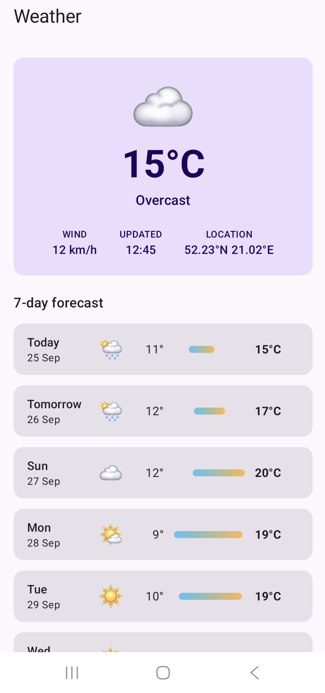
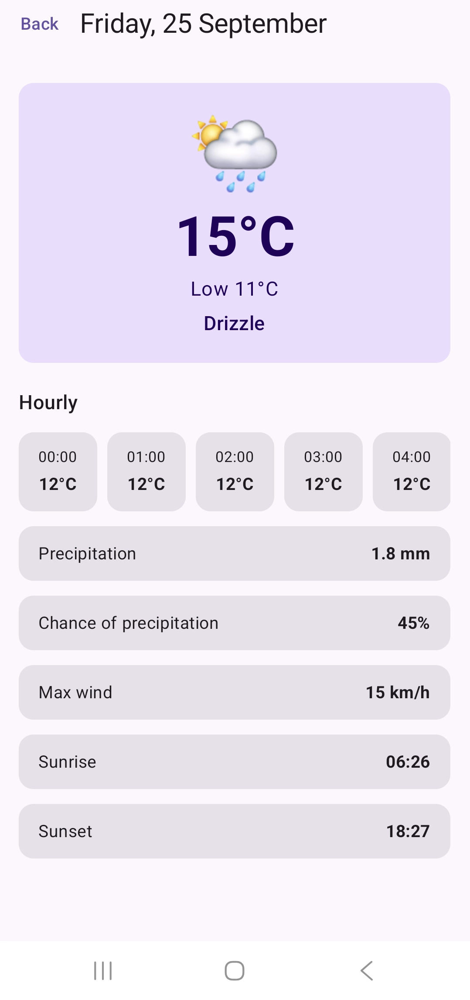
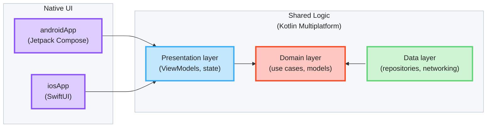

# 💎 KMP Showcase (Kotlin Toolchain)

A [Kotlin Multiplatform](https://www.jetbrains.com/help/kotlin-multiplatform-dev/get-started.html) sample application 
demonstrating how to share code for Android and iOS. The data, domain and presentation logic live in common Kotlin 
feature modules, the UI is native on each platform.

Ths app uses [Kotlin Toolchain](https://kotlin-toolchain.org/latest/) as build system. [Gradle](https://gradle.org/) equivalent can 
be found in [kmp-showcase](https://github.com/igorwojda/kmp-showcase) repository.

- [💎 KMP Showcase (Kotlin Toolchain)](#-kmp-showcase-kotlin-toolchain)
  - [Application Scope](#application-scope)
  - [Tech-Stack](#tech-stack)
  - [Architecture](#architecture)
    - [Feature Module Structure](#feature-module-structure)
      - [Presentation Layer](#presentation-layer)
      - [Domain Layer](#domain-layer)
      - [Data Layer](#data-layer)
      - [Common Module Components](#common-module-components)
  - [Build Config](#build-config)
    - [Running](#running)
    - [Dependency Management](#dependency-management)
    - [Xcode Project](#xcode-project)
  - [Design Decisions](#design-decisions)
    - [UI State Management via Flow MVI](#ui-state-management-via-flow-mvi)
      - [Consuming Common ViewModels](#consuming-common-viewmodels)
      - [Shared Store Setup](#shared-store-setup)
    - [Where Feature UI Lives](#where-feature-ui-lives)
    - [Navigation](#navigation)
    - [Dependency Injection](#dependency-injection)
  - [Caching](#caching)
  - [Naming Conventions](#naming-conventions)
    - [Screens vs Components](#screens-vs-components)
  - [Linters and CI](#linters-and-ci)
  - [Debugging FlowMVI](#debugging-flowmvi)

## Application Scope

A weather app built with KMP that displays weather for current week and each day sourced from the 
[Open-Meteo API](https://open-meteo.com/). The application demonstrates real-world scenarios including network requests, 
local caching, navigation, and state management.

**Features:**
- **Weekly Forecast** - display weekly weather forecast with daily summary and temperature range; pull to refresh
- **Daily Forecast** - display detailed daily weather forecast with hourly temperature, precipitation, wind and sunrise / sunset

<p>
  
  
</p>

## Tech-Stack

Built with modern Kotlin Multiplatform tools and libraries, prioritizing code sharing, native UI on each platform,
project structure stability and production-readiness.

**Core Technologies:**
- **[Kotlin](https://kotlinlang.org/)** - Modern, expressive programming language
  - **[Kotlin Multiplatform](https://kotlinlang.org/docs/multiplatform.html)** - Share data, domain and presentation logic between Android and iOS
  - **[Coroutines](https://kotlinlang.org/docs/coroutines-overview.html)** - Asynchronous programming
  - **[Flow](https://kotlinlang.org/docs/flow.html)** - Reactive data streams
  - **[Serialization](https://kotlinlang.org/docs/serialization.html)** - JSON parsing
  - **[kotlinx-datetime](https://github.com/Kotlin/kotlinx-datetime)** - Multiplatform date and time

**Kotlin-Swift Interop:**
- **[KMP-ObservableViewModel](https://github.com/rickclephas/KMP-ObservableViewModel)** (Kotlin library only) - Share
  Kotlin ViewModels between Android and iOS. The Swift `@StateViewModel` wrapper
  ([StateViewModel.swift](./iosApp/src/base/StateViewModel.swift)) owns the ViewModel and clears its `viewModelScope`
  when the SwiftUI view goes away
- Callback-based `StoreViewModel` API plus small Swift helpers (`Observing`, `values`) instead of SKIE (SKIE is a
  Gradle plugin and doesn't run under the Kotlin Toolchain), see [Consuming Common ViewModels](#consuming-common-viewmodels)

**Presentation:**
- **[FlowMVI](https://github.com/respawn-llc/FlowMVI)** - MVI framework (state, intents, actions, plugins)
- **[AndroidX ViewModel](https://developer.android.com/topic/libraries/architecture/viewmodel)** - Multiplatform
  lifecycle-aware ViewModel

**Android UI:**
- **[Jetpack Compose](https://developer.android.com/jetpack/compose)** - Declarative UI framework
- **[Material Design 3](https://m3.material.io/)** - Design system
- **[Navigation 3](https://developer.android.com/guide/navigation/navigation-3)** - Back stack based navigation with
  ViewModels scoped to back stack entries

**iOS UI:**
- **[SwiftUI](https://developer.apple.com/xcode/swiftui/)** - Declarative UI framework
- **[NavigationStack](https://developer.apple.com/documentation/swiftui/navigationstack)** - Value-based navigation

**Networking:**
- **[Ktor Client](https://ktor.io/docs/client-create-and-configure.html)** - Multiplatform HTTP client (Android engine on
  Android, Darwin engine on iOS)
  - **[Ktor Resources](https://ktor.io/docs/client-resources.html)** - Type-safe HTTP requests. A `@Resource` request
    class (e.g. `ForecastRequestModel`) is serialized into the URL path and query parameters, so no manual `append(...)`
  - **[Content Negotiation](https://ktor.io/docs/client-serialization.html)** - JSON (de)serialization with
    kotlinx.serialization

**Dependency Injection:**
- **[Koin](https://insert-koin.io/)** - Lightweight multiplatform dependency injection framework

**Architecture:**
- **[Clean Architecture](https://blog.cleancoder.com/uncle-bob/2012/08/13/the-clean-architecture.html)** - Separation
  of concerns with defined layers
- **MVVM + MVI** - Shared ViewModels exposing a single UI state
- **Shared logic, native UI** - Data, domain and presentation in Kotlin; Jetpack Compose and SwiftUI screens
- **Modular Design** - Feature-based modules for scalability

**Testing:**
- **[kotlin-test](https://kotlinlang.org/api/core/kotlin-test/)** - Multiplatform test library (`test` folder, run with
  `./kotlin test`)

**Build:**
- **[Kotlin Toolchain](https://kotlin-toolchain.org/latest/)** - Declarative `module.yaml` build config, self-bootstrapping
  `./kotlin` wrapper
  - **[Plugins](https://kotlin-toolchain.org/latest/user-guide/plugins/overview/)** - ktlint, Detekt and SwiftLint
    checks ([build-logic](./build-logic))
- **[Version Catalog](https://kotlin-toolchain.org/latest/user-guide/dependencies/)** - Centralized dependency
  versions ([libs.versions.toml](libs.versions.toml))

## Architecture



* [/androidApp](./androidApp) contains the Android application: entry point, Koin start-up and Navigation 3 host.

* [/iosApp](./iosApp) contains the iOS application. It builds the Kotlin framework the Swift code imports
  (`import KotlinModules`), starts Koin for iOS (see [Dependency Injection](#dependency-injection)) and holds the
  SwiftUI screens in [src/forecast](./iosApp/src/forecast) (see [Where Feature UI Lives](#where-feature-ui-lives)).

* [/feature/forecast](./feature/forecast) is the forecast feature shared between app targets in the project.
  The most important folder is [src](./feature/forecast/src) (common code).
  [src@android](./feature/forecast/src@android) holds the Jetpack Compose UI in the
  [presentation](./feature/forecast/src@android/presentation) package (`WeeklyForecastScreen`, `DailyForecastScreen`).

* [/feature/base](./feature/base) holds code shared by all feature modules, e.g. `StoreViewModel`.

* [/build-logic](./build-logic) holds the Kotlin Toolchain plugins running the linters (see [Linters and CI](#linters-and-ci)).

### Feature Module Structure

`Clean Architecture` is implemented at the module level - each feature module contains its own set of Clean
Architecture layers. The shared layers live in `src` (common code); only the view code is platform-specific. Source folders omit the
package prefix (`com.igorwojda.showcase.feature.forecast`):

```
feature/forecast/
├── module.yaml
├── src/                         common code
│   ├── presentation/            ViewModels, State, Intent, Action (shared)
│   ├── domain/
│   │   ├── model/               domain models
│   │   ├── repository/          repository interfaces
│   │   └── usecase/             use cases
│   ├── data/
│   │   ├── model/               network request / response models
│   │   └── repository/          repository implementations
│   └── di/                      Koin module
├── src@android/presentation/    Jetpack Compose screens and components
└── src@ios/di/                  Koin accessors for Swift
```

> `feature/base` doesn't follow this structure. It holds code shared by all feature modules (`StoreViewModel`,
> `configuredStore`, `HttpClient`, Koin start-up).

#### Presentation Layer

This layer is closest to what the user sees on the screen.

The `presentation` layer mixes `MVVM` and `MVI` patterns (see
[UI State Management via Flow MVI](#ui-state-management-via-flow-mvi)):

- `MVVM` - a shared ViewModel (`StoreViewModel`) encapsulates a `common UI state`. It exposes the `state` via an
  observable state holder (`Kotlin Flow`)
- `MVI` - an `intent` modifies the `common UI state` and emits a new state to a view via `Kotlin Flow`

> The `common state` is a single source of truth for each view. This solution derives from
> [Unidirectional Data Flow](https://en.wikipedia.org/wiki/Unidirectional_Data_Flow_(computer_science)) and [Redux
> principles](https://redux.js.org/introduction/three-principles).

The ViewModel and its state are written once in common code; each platform only renders the state (see
[Consuming Common ViewModels](#consuming-common-viewmodels)).

Components:

- **Screen** - a Jetpack Compose (`src@android`) or SwiftUI (`iosApp/src`) view. Observes the common state, renders
  it and passes user interactions to the `ViewModel` as intents. Views are hard to test, so they should be as simple
  as possible.
- **ViewModel** - shared across platforms. Owns a FlowMVI store, which handles intents and emits state changes and
  one-off actions to the view.
- **State** - sealed common state for a single view (e.g. `Loading` / `Content` / `Error`).
- **Intent** - user interaction sent from the view to the `ViewModel` (e.g. `Reload`).
- **Action** - one-off side effect sent from the `ViewModel` to the view (e.g. show a toast).

#### Domain Layer

This is the core layer of the application. Notice that the `domain` layer is independent of any other layers. This
allows making domain models and business logic independent from other layers. In other words, changes in other layers
will not affect the `domain` layer eg. changing the API (`data` layer) or screen UI (`presentation` layer) ideally will
not result in any code change within the `domain` layer.

Components:

- **UseCase** - contains business logic. Exposes a single `operator fun invoke` (e.g. `GetForecastUseCase`).
- **DomainModel** - defines the core structure of the data that will be used within the application. This is the source
  of truth for application data (e.g. `ForecastModel`).
- **Repository interface** - required to keep the `domain` layer independent from
  the `data layer` ([Dependency inversion](https://en.wikipedia.org/wiki/Dependency_inversion_principle)).

#### Data Layer

Encapsulates application data. Provides the data to the `domain` layer eg. retrieves data from the internet and caches
it in memory (see [Caching](#caching)).

Components:

- **Repository** - exposes data to the `domain` layer. It fetches data from the `Data Source`, keeps it in the cache and
  maps it into `domain` models (e.g. `ForecastRepositoryImpl`).
- **Mapper** - maps `data model` to `domain model` (to keep `domain` layer independent from the `data` layer). Mappers
  are private extension functions next to the repository (e.g. `ForecastResponseModel.toForecast()`).

This application has one `Data Source` - `Ktor` (network access to the [Open-Meteo API](https://open-meteo.com/)). It
consists of multiple classes:

- **Ktor HttpClient** - shared client configured in `feature/base`, with the platform engine (Android / Darwin)
- **Request Model** - a [Ktor Resources](https://ktor.io/docs/client-resources.html) `@Resource` class defining the
  endpoint, path and query parameters (e.g. `ForecastRequestModel`)
- **Response Model** - definition of the network objects for a given endpoint (e.g. `ForecastResponseModel`, with
  sub-objects such as `DailyResponseModel`)

`Response Models` are annotated with `@Serializable`, so `kotlinx.serialization` understands how to parse the data into
objects.

#### Common Module Components

Each feature module contains several standard items that provide essential functionality and configuration:

Components:
- **Module File** - `module.yaml` declaring the product (`kmp/lib` for Android and iOS), dependencies and settings.
- **Koin DI Module** - dependency injection configuration in `src` (e.g. `featureForecastModule`), plus Swift
  accessors in `src@ios` (see [Dependency Injection](#dependency-injection)).
- **Tests** - `test` folder with `kotlin-test` (no tests yet).

## Build Config

The project is built with the [Kotlin Toolchain](https://kotlin-toolchain.org/latest/). The `kotlin` (macOS/Linux) and
`kotlin.bat` (Windows) scripts in the project root download the pinned toolchain version on first use, so no separate
installation is required.

- [project.yaml](project.yaml) lists the modules.
- Each module has a `module.yaml` declaring its product type (`android/app`, `ios/app`, `kmp/lib`), dependencies and
  settings (Kotlin serialization, Compose, Android SDK levels, JVM bytecode target).
- Module dependencies are relative paths (e.g. `../feature/forecast`). A dependency marked `exported` is visible to
  modules that depend on this one, like Gradle's `api` (e.g. `feature/base` exports Koin, FlowMVI and coroutines).
- Android SDK levels (`compileSdk = 37`, `minSdk = 31`, `targetSdk = 37`) and the JVM bytecode target
  (`jvm.release: 17`) are set in each module's `settings`.

### Running

```bash
./kotlin build                    # Build all modules (Android APK, iOS app for device and simulator)
./kotlin run -m androidApp        # Run the Android app (starts an emulator if no device is connected)
./kotlin run -m iosApp            # Run the iOS app in the simulator
./kotlin test                     # Run tests
./kotlin check                    # Run tests and linters (see Linters and CI)
```

The iOS app can also be opened in Xcode: [iosApp/module.xcodeproj](iosApp/module.xcodeproj). Its `Build Kotlin` build
phase builds the Kotlin framework.

### Dependency Management

[libs.versions.toml](libs.versions.toml) holds library versions in the Gradle version catalog format (`[versions]` and
`[libraries]` sections only), referenced from `module.yaml` as `$libs.<alias>`. BOMs are imported with `bom:` (Compose,
Koin). Kotlin, Compose Multiplatform and kotlinx-serialization versions come from the toolchain's defaults.

### Xcode Project

[iosApp/module.xcodeproj](iosApp/module.xcodeproj) is managed together with the toolchain: it must keep a single app
target, the `Build Kotlin` script phase and the `KOTLIN_CLI_WRAPPER_PATH` setting. Anything else (app name, bundle id)
is regular Xcode configuration.

The iOS app has no Swift package dependencies. Android Studio's iOS run configuration builds without resolving Swift
packages, so a package dependency fails there with `Missing package product`. KMP-ObservableViewModel's Swift library
is replaced by the small `@StateViewModel` wrapper for that reason.

## Design Decisions

### UI State Management via Flow MVI

Screens are driven by [FlowMVI](https://github.com/respawn-llc/FlowMVI) stores, owned by shared ViewModels. Each screen
has one immutable `State`, a set of `Intent`s (user events) and `Action`s (one-off side effects, e.g. a toast).

- **Unidirectional data flow.** The UI sends intents and renders state, and only the store changes state. It's easy
  to follow what happened and why.
- **One state per screen.** A sealed `State` (`Loading` / `Content` / `Error`) can't represent impossible combinations.
- **Written once, used on both platforms.** State, intents and business rules live in common code; Compose and
  SwiftUI only render.
- **Plugins instead of boilerplate.** Loading (`init`), intent handling (`reduce`) and error handling (`recover`) are
  small reusable plugins, so ViewModels contain little more than the feature logic.
- **Thread-safe state updates.** `updateState` is serialized by the store, so parallel coroutines can't overwrite each
  other's changes.
- **Built-in tooling.** Logging and [remote debugging](#debugging-flowmvi) come as plugins, installed once for every
  store.

#### Consuming Common ViewModels

ViewModels extend [`StoreViewModel`](./feature/base/src/presentation/flowmvi/StoreViewModel.kt),
which owns a FlowMVI `store` (built with [`configuredStore`](#shared-store-setup)). Each platform consumes it through a different API:

| Consumer | State                                                    | Actions | Intents |
|----------|----------------------------------------------------------|---------|---------|
| Android (Compose) | `val state by viewModel.store.subscribe { action -> … }` | same `subscribe` lambda | `store.intent(…)` |
| iOS (SwiftUI) | `Observing(viewModel.watchStates) { state in … }`  | `values(viewModel.watchActions)` | `viewModel.onIntent(intent:)` |

iOS can't use `store` directly - `Store` is a Kotlin interface, exported to Swift as an Objective-C
protocol, and protocols lose their generic types. Kotlin `Flow` and `suspend` functions aren't usable from Swift without
extra tooling either. `StoreViewModel` re-exposes the store as typed callbacks:

- `watchStates(onEach:)` / `watchActions(onEach:)`: call `onEach` with every state / action until the returned `Watch`
  is cancelled. Each opens its own store subscription, so `ActionShareBehavior.Distribute` sees the screen arrive and
  leave.
- `onIntent`: accepts only the screen's own intent type.

On the Swift side, [StoreViewModelBridge.swift](./iosApp/src/base/StoreViewModelBridge.swift) adapts them:

- `values(_:)` turns a `watch…` function into an `AsyncStream`; the Kotlin subscription is cancelled when the consuming
  `.task` ends.
- `Observing` renders the latest state, and keeps the subscription open while the view is visible.

Kotlin sealed types are plain classes in Swift, so screens switch over state with `case let x as …` casts. Unlike an
exhaustive Swift enum, a new state doesn't stop the Swift code from compiling, and falls into the `default` branch.

Both callbacks read the store through FlowMVI's `subscribe`, like the Compose `subscribe` does, so plugins such as
`whileSubscribed` see the iOS screen. Android should keep using `store`, which ties the subscription to the Compose
lifecycle.

**Trade-off:** a screen that watches both states and actions holds two subscriptions. That's fine with the default
`ActionShareBehavior.Distribute`, but `ActionShareBehavior.Restrict` (one subscription per store) would throw.

#### Shared Store Setup

Every store is built with
[`configuredStore`](./feature/base/src/presentation/flowmvi/ConfiguredStore.kt)
instead of FlowMVI's `store`. It launches the store in `viewModelScope`, sets `name` and `debuggable`, and installs
logging and [remote debugging](#debugging-flowmvi). The ViewModel adds only its own plugins:

```kotlin
override val store = configuredStore(initial = WeeklyForecastState.Loading, name = "WeeklyForecast") {
    recover { … }
    init { … }
    reduce { … }
}
```

- **One place for cross-cutting setup.** A new ViewModel can't forget logging or debugging, and a change (e.g. an
  extra plugin) happens once instead of in every ViewModel.
- **Only non-default config is set.** FlowMVI defaults (e.g. `ActionShareBehavior.Distribute`) aren't repeated.
- **Custom builder over a base-class hook.** A plain extension on `StoreViewModel` wraps FlowMVI's `store` DSL
  without changing it, so ViewModels still use the standard plugins (`init`, `reduce`, `recover`).

**Known issue:** `debuggable` is hardcoded to `true`, so logging and remote debugging also run in release builds. The
fix is to take a debug flag from the app and install both only when it's set. `enableRemoteDebugging` throws on
a non-debuggable store, so both must change together.

### Where Feature UI Lives

```
feature/forecast/src/presentation/          ViewModels, state (shared)
feature/forecast/src@android/presentation/  Jetpack Compose screens and components
iosApp/src/forecast/presentation/           SwiftUI screens and components
```

- **One package for all view code.** Screens, components and UI helpers go under `presentation`
  (`presentation/<feature>`, shared helpers in `presentation/common`), on both platforms. There is no `ui` package.
- **Android** UI sits next to its shared logic, in the feature module's `src@android`. Compose is enabled in the module
  (`compose: enabled`); the toolchain doesn't allow enabling it per platform, so the Compose compiler also runs for iOS.
- **iOS** SwiftUI code lives in the iOS app module. The Kotlin Toolchain supports Swift sources only in the `ios/app`
  module's `src` folder, compiled by the Xcode target through its synchronized `src` folder. All Swift files compile into
  one Swift module, so type names must be unique.

### Navigation

Navigation is native on each platform and stays out of shared code. Shared ViewModels don't know about
routes or screens; a screen reports a user event through a callback (`onDayClick`), and the platform's
UI layer decides where to go.

| Platform | Library | Back stack | ViewModel lifetime |
|----------|---------|------------|--------------------|
| Android | [Navigation 3](https://developer.android.com/guide/navigation/navigation-3) | `rememberNavBackStack` of `@Serializable` `NavKey` routes in [`App`](./androidApp/src/App.kt) | scoped to the back stack entry (`rememberViewModelStoreNavEntryDecorator`) |
| iOS | SwiftUI `NavigationStack` | `NavigationLink(value: day.date)` + `.navigationDestination(for: LocalDate.self)` in `WeeklyForecastScreen` | owned by the destination view (`@StateViewModel`) |

- **Routes carry IDs, not data.** `DailyForecastRoute` holds only the `LocalDate`. `DailyForecastViewModel` gets it as
  a Koin parameter (`parametersOf(date)`; on iOS `Koin_iosKt.provideDailyForecastViewModel(date:)`) and reads the day from the
  repository cache (see [Caching](#caching)). Routes stay small enough to save and restore, and the screen can
  load its own data on its own, e.g. after process death.
- **One ViewModel per destination.** Each opened day gets its own `DailyForecastViewModel`, which is cleared when
  the screen is popped, on both platforms.
- **`WeeklyForecastScreen` is the start destination** on both platforms.

### Dependency Injection

[Koin](https://insert-koin.io) is used for dependency injection. All definitions live in shared code, one Koin module per module
([`baseModule`](./feature/base/src/di/BaseModule.kt),
[`featureForecastModule`](./feature/forecast/src/di/FeatureForecastModule.kt)),
so both platforms resolve the same instances.

Only the composition roots (`androidApp`'s `KMPShowcaseApplication`, `iosApp`'s
[`initializeKoin`](./iosApp/src/di/KoinInit.ios.kt)) start Koin, because only they know which features the app ships. They pass the features'
Koin modules to [`initializeKoin`](./feature/base/src/di/KoinInit.kt)
in `feature/base`, which adds `baseModule` and the platform's own config through `includes(config)`
([Koin KMP setup](https://insert-koin.io/docs/reference/koin-core/kmp-setup/)). Feature modules never start Koin, so
they don't depend on each other.

## Caching

[`ForecastRepositoryImpl`](./feature/forecast/src/data/repository/ForecastRepositoryImpl.kt)
keeps the latest forecast in an in-memory cache (guarded by a `Mutex`). The first request hits the network; `DailyForecastViewModel` then reads the day from the cache (via `GetDailyWeatherUseCase`).
Pull-to-refresh (`WeeklyForecastIntent.Refresh`) bypasses the cache (`forceRefresh = true`) and replaces the cached
value; if it fails, the current forecast stays on screen and a toast shows the error. The cached forecast expires after 15 minutes (wall clock) and is re-downloaded on the next request; the cache itself
lives as long as the process.

## Naming Conventions

### Screens vs Components

UI types are named by role, consistently on both platforms:

- **`…Screen`** — a full destination the user navigates to. Owns its root state
  (a ViewModel), takes no state from a parent, and appears in the routing layer.
  `WeeklyForecastScreen` and `DailyForecastScreen` on both platforms.
- **`…Content`** — the stateless body of a screen, rendered for its loaded state and kept in the
  screen's file (`WeeklyForecastContent`, `DailyForecastContent`, shared `ErrorContent`).
- **Everything else** — reusable parts and leaf components, named after what they are
  (`CurrentWeatherCard`, `TemperatureRangeBar`), one per file. They take values from a parent and own
  no root state. The same name is used on both platforms.

On the iOS side this deviates from Apple's idiom, where every view type is suffixed
`View` (`ContentView`, `SettingsView`) regardless of scope. The deviation is deliberate:
it keeps vocabulary aligned across the two platforms, and makes "is this navigable?"
answerable from the type name instead of only from ViewModel ownership and folder
placement. Apply it to every destination without exception.

## Linters and CI

Linters run as [Kotlin Toolchain plugins](https://kotlin-toolchain.org/latest/user-guide/plugins/overview/) from
[/build-logic](./build-logic), the counterpart of Gradle convention plugins. The toolchain has no project-wide plugins,
so each module enables the linters it needs in its `module.yaml` (`plugins:` block); each plugin is listed under
`plugins:` in [project.yaml](project.yaml).

| Linter | Plugin | Rules | Check | Fix |
|--------|--------|-------|-------|-----|
| [ktlint](https://pinterest.github.io/ktlint/) + [Compose rules](https://mrmans0n.github.io/compose-rules/) | [build-logic/ktlint](./build-logic/ktlint) | [.editorconfig](./.editorconfig) | `./kotlin check ktlint` | `./kotlin do ktlintApply` |
| [Detekt](https://detekt.dev/) | [build-logic/detekt](./build-logic/detekt) | [detekt.yml](./detekt.yml) (on top of the defaults) | `./kotlin check detekt` | `./kotlin do detektApply` |
| [SwiftLint](https://realm.github.io/SwiftLint/) | [build-logic/swiftlint](./build-logic/swiftlint) | [.swiftlint.yml](./.swiftlint.yml) | `./kotlin check swiftlint` | `./kotlin do swiftlintApply` |

- All linter versions are in [libs.versions.toml](libs.versions.toml). ktlint and Detekt run in-process. They are enabled
  in every Kotlin module, the plugin modules included, and scan the whole module folder (`src`, `src@android`,
  `src@ios`, `test`). The toolchain's `module.kotlinJavaSources` is empty for Android and KMP modules, so it can't be
  used.
- SwiftLint is enabled in `iosApp` and lints `iosApp/src`. The plugin downloads the release set by `swiftlint` in
  `libs.versions.toml` and verifies it against the checksums in [plugin.yaml](./build-logic/swiftlint/plugin.yaml)
  (update both together), so no installation is needed (Linux uses the statically linked binary). Warnings fail the
  check (`--strict`).
- Detekt writes HTML and XML reports to `build/tasks/_<module>_detektCheck@detekt/`.
- `./kotlin check` runs all linters plus the tests; `-m <module>` limits it to one module.
- Detekt's `InvalidPackageDeclaration` is disabled: toolchain source folders omit the module's package prefix.
- Android Lint is not migrated yet; its rules are kept in [lint.xml](./lint.xml).

The [Check](./.github/workflows/check.yml) GitHub Actions workflow runs on every pull request and on `main`:
`Build Android App` (uploads the debug APK), `Build iOS App` (simulator), `Detekt` (uploads the report), `ktlint`
and `SwiftLint`. Jobs need no JDK setup: the `./kotlin` wrapper provisions everything, cached with `actions/cache`
(the iOS job also caches `~/.konan`: a cold Kotlin/Native link builds its caches silently for several minutes).

## Debugging FlowMVI

[FlowMVI](https://github.com/respawn-llc/FlowMVI) 
provides [Remote Debugging](https://opensource.respawn.pro/FlowMVI/plugins/debugging).

In this project remote debugging host is set to `"127.0.0.1"` ip address (`enableRemoteDebugging(host = "127.0.0.1")` in `configuredStore`). 
To make debugging work on Android physical device run `adb reverse tcp:9684 tcp:9684` command.

The Android app allows cleartext traffic to the debugger hosts ([network_security_config.xml](./androidApp/res/xml/network_security_config.xml)).
The Kotlin Toolchain has no debug-only Android sources, so this applies to release builds too.
